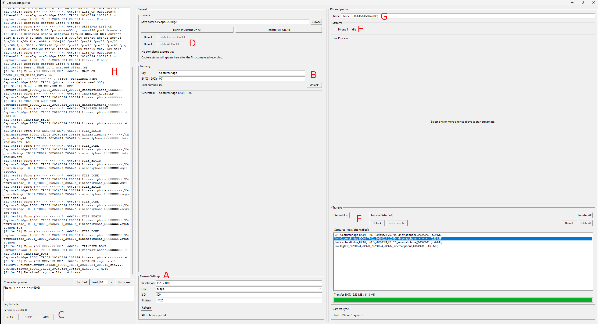

# CaptureBridge Hub

CaptureBridge is a local or USB-connected acquisition system for smartphone-based
markerless motion-analysis workflows. CaptureBridge Hub is the Windows desktop
control app: it connects to CaptureBridge Android clients over a local network
or USB/ADB reverse transport, keeps capture names and camera settings aligned,
starts and stops all phones together, transfers recordings back to the PC, and
can bridge trigger events to Arduino and Vicon lab workflows.

The goal is repeatable acquisition, not a locked-in analysis algorithm. The Hub
collects organized phone videos and metadata that can be used downstream with
single-camera monocular analysis, multi-camera reconstruction, video-to-pose
workflows, mesh-based pose estimation, or OpenSim-compatible
inverse-kinematics pipelines.

The Hub is the session authority. Android clients pre-arm Camera2/MediaCodec
recording pipelines and return video plus metadata. USB/ADB reverse or a trusted
private network carries control, status, preview, and operator-requested file
transfers. An optional Arduino serial bridge exchanges start/stop events with a
marker-based or other laboratory reference system.

## Companion Android App

CaptureBridge Hub is designed to work with the CaptureBridge Android phone
client. For normal lab use, download the Android APK from the
[CaptureBridge Android v1.0.15 release](https://github.com/USTP-Biomechanics/CaptureBridge-Android/releases/tag/v1.0.15).
The phone app source lives in
[USTP-Biomechanics/CaptureBridge-Android](https://github.com/USTP-Biomechanics/CaptureBridge-Android).

## Compatible Release Pair

The release pair archived for the CaptureBridge SoftwareX submission is:

- [CaptureBridge Hub v1.0.10](https://github.com/USTP-Biomechanics/CaptureBridge-Hub/releases/tag/v1.0.10)
- [CaptureBridge Android v1.0.15](https://github.com/USTP-Biomechanics/CaptureBridge-Android/releases/tag/v1.0.15)

Use these two versions together when reproducing the published software
configuration. Future releases may change the protocol or installation
instructions.

Important connection note: the Hub can connect to Android phones over USB with
ADB reverse port forwarding, which needs Android SDK Platform-Tools on the PC
(see [USB And ADB](#usb-and-adb)), or over the local Wi-Fi/LAN discovery path.
Wi-Fi use usually needs the PC and phones on the same private network, Windows
should use the Private network profile, and firewall exceptions are commonly
required for TCP `6000`, UDP `6000`, and the phone streaming UDP port `6101`.

## Quick Start

For normal use, download the portable release ZIP from the
[CaptureBridge Hub v1.0.10 release](https://github.com/USTP-Biomechanics/CaptureBridge-Hub/releases/tag/v1.0.10),
extract it, download and install the Android APK from the
[CaptureBridge Android v1.0.15 release](https://github.com/USTP-Biomechanics/CaptureBridge-Android/releases/tag/v1.0.15),
and start the Windows app with the BAT file. That is the easiest path and does
not require Python or internet access on the lab PC.

### Recommended Portable Release

1. Download `CaptureBridge_Hub_Minimal_Offline.zip` from the
   [CaptureBridge Hub v1.0.10 release](https://github.com/USTP-Biomechanics/CaptureBridge-Hub/releases/tag/v1.0.10).
2. Download the adjacent `.sha256` file and compare its first field with:

   ```powershell
   (Get-FileHash -Algorithm SHA256 .\CaptureBridge_Hub_Minimal_Offline.zip).Hash.ToLowerInvariant()
   ```

3. Extract the ZIP to a normal folder, for example `Documents` or `Desktop`.
4. Download the Android APK from the
   [CaptureBridge Android v1.0.15 release](https://github.com/USTP-Biomechanics/CaptureBridge-Android/releases/tag/v1.0.15)
   and copy it to the phone if needed.
5. Install the downloaded APK on the phone. If Android asks, allow installing
   this APK from the file manager or browser you are using.
6. Connect the phone over USB with USB debugging enabled, or put the PC and
   phone on the same private Wi-Fi or LAN. USB also needs Android SDK
   Platform-Tools on the PC; see [USB And ADB](#usb-and-adb).
7. On the PC, double-click `Run_CaptureBridge_Hub.bat` in the extracted folder.
8. Allow Windows firewall access on Private networks when prompted.
9. Start the CaptureBridge Android app on the phone.
10. Confirm the phone appears in CaptureBridge Hub.
11. Fill in the session naming fields and confirm the camera profile is synced.
12. Press `START`, then `STOP`.
13. Transfer the current capture or all captures from the Hub.

The portable Hub release includes the Windows app, its Python runtime, and the
Arduino/Vicon bridge files. The Android APK is published separately in the
[CaptureBridge Android v1.0.15 release](https://github.com/USTP-Biomechanics/CaptureBridge-Android/releases/tag/v1.0.15).
No separate Python install is needed.

### Repo Run For Development

Use the BAT files. That is the intended way to run the app from a checked-out
repository.

1. Put the PC and phones on the same private network.
2. Double-click [Run_CaptureBridge_Hub.bat](Run_CaptureBridge_Hub.bat).
3. If this is the first repo run, the launcher automatically calls
   [Setup_CaptureBridge_Hub.bat](Setup_CaptureBridge_Hub.bat).
4. Allow Windows firewall access on Private networks when prompted.
5. Start the CaptureBridge Android clients. Android phones can connect over
   USB/ADB reverse first, then fall back to Wi-Fi discovery.
6. Confirm the phones appear in CaptureBridge Hub.

If setup reports that Python is missing, install Python 3 for Windows and run
[Run_CaptureBridge_Hub.bat](Run_CaptureBridge_Hub.bat) again.

## Interface Overview



The red labels in the screenshot mark the main operator areas:

- **A**: Global camera profile for shutter, resolution, FPS, and ISO. These
  settings are synced to the connected phones before capture. A shorter
  shutter can reduce motion blur but needs more light; higher ISO brightens the
  image but can add noise. Above 60 fps, for example at 240 fps, the exposure
  time is fixed at about one frame period (about 4 ms at 240 fps), so a shorter
  shutter cannot reduce motion blur there; the phone keeps auto exposure and
  matches the image brightness of the entered ISO and shutter automatically.
  See [Configuration](#configuration) for saved defaults and high-speed
  exposure.
- **B**: Capture naming fields. The generated capture name is sent to all
  phones before recording. The fields, choices, order, and output formatting can
  be changed in [app_config.json](app_config.json).
- **C**: Session controls. `START` and `STOP` control all connected phones.
  `ARM` listens for Arduino or Vicon trigger input when the bridge is connected.
  `Lag Test` checks the selected phone's saved-segment boundary timing with a
  visual target on the left half of the screen; it is not solely a
  network-latency test.
  `Disconnect` turns off phone networking when needed. If the phones are not
  in silent mode, each phone plays a tone when capture starts and stops. See
  [Lag Test](#lag-test), [Arduino Bridge](#arduino-bridge), and
  [Vicon Nexus Integration](#vicon-nexus-integration).
- **D**: Global transfer and delete actions for all phones. Transfers are saved
  to the selected folder. Delete actions must be unlocked before the delete
  buttons can be used.
- **E**: Live preview stream controls. A single phone can usually stream at
  `1920 x 1080`; for multiple simultaneous streams, reduce the stream
  resolution or max dimension. Streaming can use UDP over Wi-Fi or TCP through
  USB/ADB reverse, and it drains phone batteries faster. See
  [Phone Live Preview](#phone-live-preview).
- **F**: Captures and files stored on the phone selected in **G**.
- **G**: Phone selector for per-phone file lists, transfers, deletes, and status.
  Compatible phones append their battery percentage and charging state to the
  connected-phone and selector labels.
- **H**: Log output for discovery, connection, sync, transfer, stream, and
  troubleshooting messages.

## Network And Firewall

CaptureBridge Hub listens on:

- TCP `6000`: phone control, capture commands, file transfer, delete, and camera settings
- UDP `6000`: phone discovery
- UDP `6101`: raw phone live preview stream

For Android, the default transport mode is `adb_reverse_first`: the Hub watches
for authorized USB devices, sets up ADB reverse forwarding for TCP `6000` and
the preview stream port, and Android tries USB before Wi-Fi discovery. If USB is
not available, phones discover the PC automatically over UDP. If discovery or
streaming does not work, check these first:

- For USB: the phone is authorized for USB debugging and Android SDK
  Platform-Tools (`adb.exe`) is installed on the PC; see
  [USB And ADB](#usb-and-adb).
- For Wi-Fi: PC and phones are on the same Wi-Fi or LAN segment.
- For Wi-Fi: Windows network profile is set to Private.
- For Wi-Fi: inbound firewall rules allow TCP `6000`, UDP `6000`, and UDP `6101`.
- VPNs, guest Wi-Fi isolation, and strict corporate networks are not blocking local traffic.

PowerShell firewall rules, run as Administrator:

```powershell
New-NetFirewallRule -DisplayName "CaptureBridge Hub UDP Discovery 6000" -Direction Inbound -Protocol UDP -LocalPort 6000 -Action Allow -Profile Private
New-NetFirewallRule -DisplayName "CaptureBridge Hub TCP Control 6000" -Direction Inbound -Protocol TCP -LocalPort 6000 -Action Allow -Profile Private
New-NetFirewallRule -DisplayName "CaptureBridge Hub Phone Stream UDP 6101" -Direction Inbound -Protocol UDP -LocalPort 6101 -Action Allow -Profile Private
```

Legacy `netsh` alternative:

```cmd
netsh advfirewall firewall add rule name="CaptureBridge Hub UDP Discovery 6000" dir=in action=allow protocol=UDP localport=6000 profile=private
netsh advfirewall firewall add rule name="CaptureBridge Hub TCP Control 6000" dir=in action=allow protocol=TCP localport=6000 profile=private
netsh advfirewall firewall add rule name="CaptureBridge Hub Phone Stream UDP 6101" dir=in action=allow protocol=UDP localport=6101 profile=private
```

### USB And ADB

USB connections need Android SDK Platform-Tools (`adb.exe`) on the PC; the Hub
does not include it. Use one of these:

- Android Studio: `SDK Manager` > `SDK Tools` > `Android SDK Platform-Tools`
- `winget install Google.PlatformTools`
- extract the [Platform-Tools ZIP](https://developer.android.com/tools/releases/platform-tools)
  so that its `platform-tools` folder sits next to `Run_CaptureBridge_Hub.bat`
- set `phone_transport.adb_path` in [app_config.json](app_config.json) to
  `adb.exe` or to the folder that contains it

The Hub looks for `adb.exe` in this order: `phone_transport.adb_path`, a
`platform-tools` folder next to `Run_CaptureBridge_Hub.bat`, `ANDROID_HOME` and
`ANDROID_SDK_ROOT`, the Android Studio SDK (`%LOCALAPPDATA%\Android\Sdk`),
`PATH`, the Visual Studio/Xamarin SDK
(`%ProgramFiles(x86)%\Android\android-sdk`), and the SDK bundled with Unity Hub
editors. A configured `adb_path` that runs is always used. Among the other
copies it prefers adb 1.0.41 or newer, because an adb client with a different
version restarts the running adb server and drops every USB connection.

The USB state is shown next to the server address and in the log:

- `ADB: searching for adb.exe...`: the search is running.
- `USB unavailable: adb.exe not found - ...`: no usable `adb.exe` was found.
  Wi-Fi keeps working, and the Hub searches again every 10 seconds, so a
  Platform-Tools folder or Android Studio SDK installed while the Hub runs is
  picked up without a restart. After `winget install`, restart the Hub, because
  `PATH` changes reach only programs started afterwards.
- `ADB: 1 ready, USB reverse 1/1`: one authorized phone, and the number of
  ready phones whose control port `6000` is forwarded over USB.
- `; authorize USB debugging on phone` or `; reconnect offline phone`: accept
  the USB debugging prompt on the phone, or replug the cable.
- `; reverse failed: tcp:<port>: <error>`: adb refused the forwarding; the log
  names the phone.

ADB drops reverse forwarding when the adb server restarts, for example after
`adb kill-server` or when another tool runs a different adb version, and when
the phone reconnects. The Hub checks the forwarding on every poll
(`adb_poll_interval_sec`, 3 seconds by default) and re-creates lost entries
within one poll; the log then shows `ADB reverse restored for ...`.

## Security And Data Handling

CaptureBridge is designed for an authorized USB connection or an isolated,
trusted private WLAN/LAN. The current protocol does not provide pairing,
authentication, authorization between connected peers, TLS, or payload
encryption. Do not expose the control, discovery, or preview ports to the
internet, a guest network, or another untrusted network. Prefer USB/ADB reverse
for sensitive recordings and restrict Windows firewall rules to the Private
profile.

Android captures stay in the app's private storage until the operator requests
a transfer. The Hub accepts file payloads only during that request, enforces
per-file and per-request limits, writes to a temporary partial path, and
publishes the final file only after the declared byte count and matching
FILE_DONE are verified. An interrupted or invalid transfer removes its partial
file. These controls reduce accidental or malicious writes, but they do not add
confidentiality to an unencrypted network connection.

Battery messages contain only the latest integer charge percentage, normalized
charge state, and plugged source. The Hub displays these values and does not
persist a battery history or estimate current, power, energy, or battery life.

## Citation

If you use CaptureBridge Hub in academic work, cite this repository and the
companion Android client:

```text
Simonlehner, M. (2026). CaptureBridge Hub: Windows controller for coordinated
smartphone video acquisition [Computer software]. Version 1.0.10.
https://github.com/USTP-Biomechanics/CaptureBridge-Hub
https://github.com/USTP-Biomechanics/CaptureBridge-Android
```

The repository also includes [CITATION.cff](CITATION.cff), which GitHub uses
for the `Cite this repository` button.

## Support

For questions, contact mark.simonlehner@ustp.at. Reproducible software defects
can also be reported through the
[Hub issue tracker](https://github.com/USTP-Biomechanics/CaptureBridge-Hub/issues).
Do not attach identifiable participant videos or other sensitive data to a
public issue.

## Running The App

### Offline Portable Run

For a lab PC that should not need Python or internet access:

1. Download and extract `CaptureBridge_Hub_Minimal_Offline.zip` from the
   [CaptureBridge Hub v1.0.10 release](https://github.com/USTP-Biomechanics/CaptureBridge-Hub/releases/tag/v1.0.10).
2. Install the Android APK from the
   [CaptureBridge Android v1.0.15 release](https://github.com/USTP-Biomechanics/CaptureBridge-Android/releases/tag/v1.0.15)
   on the Android phone.
3. Connect the Android phone by USB with USB debugging enabled, or put the PC
   and phone on the same private Wi-Fi or LAN. USB also needs Android SDK
   Platform-Tools on the PC; see [USB And ADB](#usb-and-adb).
4. Double-click `Run_CaptureBridge_Hub.bat` inside the extracted folder.
5. Allow Windows firewall access on Private networks if prompted.

The offline package includes the app, portable CPython with Tkinter, `pyserial`,
`Pillow`, and the Arduino bridge files. The Android client APK is published in
the [CaptureBridge Android v1.0.15 release](https://github.com/USTP-Biomechanics/CaptureBridge-Android/releases/tag/v1.0.15).

### Normal Repo Run

Double-click:

```text
Run_CaptureBridge_Hub.bat
```

The launcher checks for `.venv`. If the environment is missing, it runs
`Setup_CaptureBridge_Hub.bat`, creates the local virtual environment, installs
[requirements.txt](requirements.txt), and starts the app.

The portable release is built from
[requirements-release.txt](requirements-release.txt), which pins the tested
dependency versions exactly. Development installs use the compatible ranges in
requirements.txt.

## Repository Layout

The repository keeps executable source under [src/](src/) for SoftwareX
submission compatibility.

- [src/tcp_arduino_sync.py](src/tcp_arduino_sync.py): desktop app
- [src/phone_protocol.py](src/phone_protocol.py): battery/status parsing and
  thread-safe phone clock synchronization
- [src/phone_stream.py](src/phone_stream.py): UDP/TCP phone preview receiver and Tk preview UI
- [src/android_adb.py](src/android_adb.py): Android device discovery and ADB reverse helpers
- [src/lag_test/](src/lag_test/): timing target, video analyzer, and report writer for lag tests
- [app_config.json](app_config.json): save path, naming fields, and stream settings
- [requirements.txt](requirements.txt): Python dependencies for repo runs
- [Run_CaptureBridge_Hub.bat](Run_CaptureBridge_Hub.bat): normal launcher
- [Setup_CaptureBridge_Hub.bat](Setup_CaptureBridge_Hub.bat): normal setup helper
- [src/ArduinoBridge/](src/ArduinoBridge/): Arduino sketch and Vicon monitor definition
- [packaging/](packaging/): offline ZIP builder and files copied into the package

## Main Features

- Multi-phone control for CaptureBridge Android clients
- UDP discovery plus TCP control on port `6000`
- Shared live capture name with validation and automatic re-send until acknowledged
- Global `START` and `STOP` broadcast
- Shared camera settings for resolution, FPS, ISO, shutter, and high-speed
  exposure compensation
- Start is guarded until connected phones report the shared camera profile
- Selected-phone visual boundary-timing test for checking the first and last
  saved frames against a recorded timing target
- Per-phone capture lists and transfer controls
- Global transfer for the current capture or all captures
- Unlock-guarded delete actions for one phone or all phones
- Raw live preview grid with one checkbox per phone
- Offline portable distribution build
- Arduino serial bridge at `9600` baud
- Vicon trigger workflows through the bundled Arduino bridge

## Phone Live Preview

The Phone Specific panel includes a `Streams` section with one checkbox per
connected phone. Check one phone to open one preview, or check multiple phones
to open a modular preview grid.

The stream uses the phone control connection plus a separate preview channel:

- TCP `6000` remains the control channel.
- UDP `6101` carries chunked JPEG preview frames over Wi-Fi.
- TCP on the configured stream port carries the same chunked JPEG frames when a
  USB/ADB reverse connection is used.

The app sends `LIVE_PREVIEW_START` with the PC host, stream port, FPS, JPEG
quality, max dimension, transport protocol, and optional stream key. The phone
sends preview frames only after that request. Unchecking the phone or closing
the app sends `LIVE_PREVIEW_STOP`. In modes above 60 fps, CaptureBridge Android
1.0.16 and newer keep the high-speed recording session running while streaming
and send snapshots of its preview at the stream FPS, so the stream shows the
real high-speed exposure and recording keeps working while it streams.

Stream settings live under `phone_stream` in [app_config.json](app_config.json):

- `enabled`
- `udp_port`
- `max_fps`
- `jpeg_quality`
- `max_dimension`
- `socket_buffer_bytes`

Transport settings live under `phone_transport` in [app_config.json](app_config.json):

- `mode`: `adb_reverse_first` or `wifi_only`
- `adb_path`: optional path to `adb.exe` or to the folder that contains it.
  Relative paths are resolved relative to the repo or package app folder; a
  bare name such as `adb.exe` is also looked up on `PATH`. `~` and
  `%VARIABLES%` are expanded. Leave it empty to use the search order in
  [USB And ADB](#usb-and-adb).
- `adb_poll_interval_sec`: how often USB phones and their forwarding are
  checked, in seconds (1-60, default 3)

## Operator Workflow

1. Start CaptureBridge Hub with [Run_CaptureBridge_Hub.bat](Run_CaptureBridge_Hub.bat).
2. Confirm all phones are connected in the left panel.
3. Choose or confirm the transfer save path.
4. Fill in the naming fields until the generated capture name is valid.
5. Confirm the shared camera settings and wait for sync confirmation.
6. Use Phone Specific preview checkboxes if you want live views.
7. Press `START`.
8. Press `STOP`.
9. Transfer the current capture or all captures.
10. Use delete controls only after unlocking the relevant delete section.

## Lag Test

Select a phone in `Connected phones` and press `Lag Test` to check the first and
last saved-frame boundary timing for that phone, camera mode, lighting,
transport, and trigger setup. The name is retained in the user interface for
compatibility; the test evaluates the complete visual acquisition path rather
than only network latency. The Hub prepares the selected phone, opens a
timing target on the left half of the screen, refreshes Hub-to-phone clock
samples, and uses scheduled phone-clock commands (`START_AT` / `STOP_AT`) when the current
time-sync samples are good enough. If scheduled timing is not usable, it falls
back to immediate `START` / `STOP`. The test then transfers the video and writes
JSON/CSV timing reports next to the transferred MP4.

Phone timing responses include `phone_rx_ns` and `phone_tx_ns`; the Hub keeps
those raw fields for tooling and logs the compact
`phone_rx_tx_delta_ms=<value>` summary for readability. Lag reports include
command timing, phone-clock target fields, segment cut offsets from
`.segment.json`, and analyzer frame timing. Use those fields to separate
transport timing problems from camera-frame selection or visual target analysis
issues. They also record the phone's camera settings in `camera_*` fields: mode
(`camera_width`, `camera_height`, `camera_fps`, `camera_high_speed`), the
requested `camera_iso` and `camera_shutter_seconds`, and above 60 fps the
exposure compensation the phone applied (`camera_high_speed_ae_compensation_mode`,
`camera_high_speed_ae_compensation_applied_ev`). A field is empty in the CSV and
`null` in the JSON report when the phone app does not report it.

For reliable analysis, aim the phone at the timing target on the left half of the
screen and make sure the complete green border is visible in the recorded video.
If any side of the green border is cropped out, the analyzer may not be able to
read the start/stop target cleanly.

The raw lag (`start_lag_ms`, `stop_lag_ms`) compares the decoded timecode with
the moment the Hub computed it, so it includes the PC's screen pipeline: on
Windows a windowed timing target reaches the screen a few refresh periods after
it is drawn (about 12 ms at 240 Hz on the lab PC), which reads as an "early"
camera. On Windows the Hub therefore also records, for every displayed
timecode, the desktop compositor's (DWM) vertical blank at which it was scanned
out. The report adds `screen_start_lag_ms` and `screen_stop_lag_ms`: the
endpoint lag against the middle of the screen-time span during which the
decoded timecode was shown, with `screen_*_half_width_ms` as the +/- half-width
of that span (about one refresh period). `screen_*_residual_ms` also subtracts
how far the phone's chosen boundary frame lies from the target
(`chosen_start_offset_us`, `end_offset_error_us`), so frame snapping at 60 fps
does not show up as lag. These values are measured in every run; no fixed
correction is applied, and only directly decoded endpoints get them. Two
delays are not included: the monitor's own processing, which Windows cannot
see, and the phone sensor's rolling-shutter readout (rows are exposed one after
another, so the marker rows can be exposed several milliseconds after the
frame timestamp). The log line `Lag test vs screen time` shows the values;
`screen_timing_source` is `unavailable` where DWM timing is not available, and
the raw fields keep their previous meaning.

Above 60 fps, for example at 240 fps, Android uses auto exposure and the
exposure time stays at about one frame period (about 4 ms at 240 fps), so
`camera_shutter_seconds` is not the exposure the sensor used. The phone instead
sets the auto-exposure compensation so the image is as bright as the requested
ISO and shutter would make it; a short requested shutter therefore lowers the
sensor gain and noise. In the author's Samsung Galaxy S25 Ultra checks, a
bright target background plus `-2.0` EV raised the share of 1080p240 lag tests
whose endpoint frames the analyzer decoded directly, rather than inferring them
from neighboring frames, from 60-67% to 80%; with a short requested shutter
such as ISO `800` at `1/2000 s` the automatic value goes toward that `-2.0` EV
limit in a dim room. See [Configuration](#configuration) for how it is applied.

For compatible Android clients, `STOP_MARKED` is used as the stop timing
acknowledgement because it is sent immediately after the phone marks the stop
timestamp. `STOP_OK MEDIACODEC_MUXED` is then used as the file-ready signal
before transfer lookup, and `READY PREVIEW` / `READY_ERR ...` describe whether
the camera preview was restored after muxing.
After `STOP_OK`, the Hub waits briefly for `READY` or `READY_ERR` so that
preview rearm status is visible, then continues with transfer lookup even if no
ready message arrives.

In an illustrative Samsung Galaxy S25 Ultra bench check against a 144 Hz
display, both endpoints were observed within 0--2 captured frames at 240 fps
(0--8.33 ms) and 0--1 frame at 60 fps (0--16.67 ms). The display refresh period
was 6.94 ms. This is a setup-specific, author-reported frame-scale observation,
not traceable timing metrology or a phone-to-phone synchronization guarantee.
The exact scope, conversion, limitations, and reproduction steps are published
under [validation/](validation/).

## User Interface

The app window is organized around the annotated areas shown in
[Interface Overview](#interface-overview). The left side is used for connection
state, log output, and session controls; the middle area is used for global
camera, naming, transfer, and delete actions; the right side is used for
per-phone streams, file lists, transfers, deletes, and status.

## Arduino Bridge

Upload [ArduinoBridge.ino](src/ArduinoBridge/ArduinoBridge.ino) before using the
hardware bridge. Close CaptureBridge Hub before uploading, because the app opens
the Arduino serial port when it starts and the Arduino IDE cannot upload while
that port is in use.

The bundled sketch defaults to:

- serial baud rate `9600`
- digital output `D10`
- analog input `A0`

PC to Arduino:

- `1`: set the output pin high
- `0`: set the output pin low
- `PING`: request the bridge identity for safe port detection

Arduino to PC when `ARM` is enabled:

- `START` or `1`
- `STOP` or `0`

The sketch converts `A0` threshold crossings into start and stop messages and
debounces the signal. It replies to `PING` with
`CAPTUREBRIDGE_ARDUINO_BRIDGE`, which lets the desktop app avoid opening random
serial devices as if they were the bridge.

Useful sketch constants:

- `OUTPUT_PIN`
- `START_THRESHOLD`
- `STOP_THRESHOLD`
- `SAMPLE_INTERVAL_MS`
- `STATE_DEBOUNCE_MS`

## Vicon Nexus Integration

CaptureBridge can work with Vicon in either direction.

CaptureBridge-led:

1. Press `START` or `STOP` in CaptureBridge Hub.
2. The PC sends `1` or `0` to the Arduino.
3. The Arduino drives the configured digital output.
4. Vicon reacts to that signal.

Vicon-led:

1. Configure Vicon analog output in Lock Lab.
2. Wire Vicon signal output to Arduino `A0`.
3. Wire Vicon ground to Arduino analog ground.
4. Start CaptureBridge Hub.
5. Press `ARM`.
6. Vicon signal changes are converted by Arduino into `START` or `STOP` for the hub.

For common Vicon trigger wiring, set `OUTPUT_PIN` to `7` in
[ArduinoBridge.ino](src/ArduinoBridge/ArduinoBridge.ino) before upload. The
included [ArduinoTrigger.Monitors](src/ArduinoBridge/ArduinoTrigger.Monitors) file
is a reference for threshold-based Vicon start and stop actions.

## Configuration

CaptureBridge Hub reads [app_config.json](app_config.json) at startup.

Important settings:

- `default_save_path`: where transferred phone files are written by default
- `name_separator`: separator used in the generated capture name
- `name_fields`: the ordered fields shown in the naming UI
- `phone_stream`: live preview settings
- `phone_transport`: USB/ADB reverse and Wi-Fi transport preference
- `camera_defaults`: first-run camera defaults before a saved camera profile
  exists: `preferred_width`, `preferred_height`, `iso`, and
  `shutter_fps_multiplier`

On first startup, the app prefers a shared `1920 x 1080` camera mode and selects
the highest FPS available for that mode across the connected phones. It starts
with ISO `800`, a shutter of `1 / (2 * fps)`, which is the standard 180-degree
shutter baseline. After camera settings are
changed, the last profile is saved locally in `capturebridge_state.json` and
reused on the next startup.

For motion analysis, `1 / (2 * fps)` is a sensible starting point. If motion
blur is still too visible and lighting allows it, try `1 / (4 * fps)` or faster.
ISO `800` is a clean starting value in a well-lit lab; use `1600` or `2000` if
the image is too dark at higher FPS. ISO and shutter apply only up to 60 fps.

Modes above 60 fps, for example 240 fps, run in an Android constrained
high-speed session. Android forces auto exposure there and the exposure time
stays at about one frame period (about 4 ms at 240 fps on the tested Samsung
Galaxy S25 Ultra), so **the shutter is fixed above 60 fps** and a shorter
shutter setting cannot reduce motion blur in those modes. CaptureBridge Android
1.0.16 and newer still honor the entered ISO and shutter as a brightness
target: the phone measures the exposure time and gain that auto exposure
chooses and sets the auto-exposure compensation so that exposure time x ISO
matches shutter x ISO as requested, rounded to the phone's compensation step
and clamped to its range (usually -2 to +2 EV). It adjusts only between
recordings, never during one, and remembers the value per camera mode. Older
phone apps keep plain auto exposure in these modes. See [Lag Test](#lag-test)
for the effect on high-speed lag tests.

Supported name field types:

- `text`
- `choice`
- `number`

Useful field options:

- `value_map`: turn a displayed choice into a shorter filename token
- `output_prefix`, `output_suffix`: add text around a field only in the generated capture name
- `allow_custom`: allow free text in a choice field
- `min`, `max`, `pad_to`: numeric validation and zero padding
- `lockable`: add a lock/unlock button
- `locked_by_default`: start a field locked
- `auto_increment_on_stop`: increment a numeric field after `STOP`

Relative `default_save_path` values are resolved relative to the repo or package
app folder.

Default generated name example:

```text
CaptureBridge_ID001_TR001
```

## Offline Package Build

Build the portable offline ZIP with:

```powershell
.\packaging\Build-MinimalOffline.ps1
```

The ZIP is written to:

```text
dist/CaptureBridge_Hub_Minimal_Offline.zip
```

The builder copies:

- app source files
- lag-test helper package
- minimal app config
- launcher BAT
- package README
- license and citation metadata
- README image assets
- [src/ArduinoBridge/](src/ArduinoBridge/)
- portable Python runtime
- `pyserial`
- `Pillow`
- `numpy`
- `opencv-contrib-python`

If a local `.venv` exists, the builder can use the Python installation behind
that environment. Without `.venv`, it downloads the configured CPython installer
unless you pass `-PythonInstallerPath` or `-SourcePythonDir`.

### GitHub Release Build

The GitHub Actions workflow in `.github/workflows/release.yml` builds the
offline ZIP on a Windows runner and uploads
`CaptureBridge_Hub_Minimal_Offline.zip` together with
`CaptureBridge_Hub_Minimal_Offline.zip.sha256` as GitHub Release assets. The
generated `dist/` folder is ignored and does not need to be committed.

To create a release from a tag:

```powershell
git tag v1.0.0
git push origin v1.0.0
```

You can also run the `Build Release Zip` workflow manually from the GitHub
Actions tab and enter the release tag name.

## Phone Protocol Summary

UDP discovery:

- request: `DISCOVER_UDPCAMERA`
- response: `UDPCAMERA_OK 6000`

Desktop to phone over TCP:

- `NAME <generated_name>`
- `PING <payload>`
- `SYNC <seq> hub_tx_ns=<ns>`
- `PREPARE <json>` for lag-test recorder preparation
- `ARM [<json>]`
- `START`
- `START_AT phone_elapsed_ns=<ns>`
- `STOP`
- `STOP_AT phone_elapsed_ns=<ns>`
- `LIST`
- `GET <capture_name>`
- `GET_ALL`
- `DELETE <capture_name>`
- `DELETE_ALL`
- `SETTINGS_LIST`
- `SETTINGS <json>`
- `LIVE_PREVIEW_START <json>`
- `LIVE_PREVIEW_STOP`

Phone to desktop over TCP:

- `HELLO <device_name>`
- `TRANSPORT <usb_adb_reverse|wifi|direct> host=<host>`
- `PONG <payload> phone_elapsed_ns=<ns> phone_rx_ns=<ns> phone_tx_ns=<ns>`
- `SYNC_OK seq=<seq> hub_tx_ns=<ns> phone_rx_ns=<ns> phone_tx_ns=<ns>`
- `NAME_OK [generated_name]`
- `BATTERY level_pct=<0-100> status=<state> plugged=<source>`
- `PREPARE_OK [timing_fields]`
- `PREPARE_ERR <reason>`
- `LIST_OK <json>`
- `FILE_BEGIN <relative_path> <size_bytes>`
- `FILE_DONE <relative_path>`
- `TRANSFER_ACCEPTED`
- `TRANSFER_BEGIN ...`
- `TRANSFER_DONE`
- `TRANSFER_ALL_DONE`
- `TRANSFER_ERR <reason>`
- `SETTINGS_LIST_OK <json>`
- `SETTINGS_OK <json>`
- `SETTINGS_ERR <reason>`
- `DELETE_OK <capture_name|ALL>`
- `DELETE_ERR <reason>`
- `START_OK`
- `STOP_MARKED [timing_fields]`
- `STOP_OK [status timing_fields]`
- `STOP_ERR <reason>`
- `READY PREVIEW`
- `READY_ERR <reason>`
- `BUSY <reason>`
- `ERR_UNKNOWN`
- `LIVE_PREVIEW_STATE <json|text>`

Payload notes:

- `LIST_OK` should include a `captures` array.
- Each capture should include at least `name`, `totalBytes`, and `files`.
- File transfer uses `FILE_BEGIN`, raw bytes, then `FILE_DONE`.
- `NAME_OK` may include the echoed generated name; if it does not, the Hub uses
  the last name it sent to that phone.
- `BATTERY` is an unsolicited status update. `status` is `charging`, `full`,
  `discharging`, `not_charging`, or `unknown`; `plugged` is `usb`, `ac`,
  `wireless`, `dock`, `none`, or `unknown`. Compatible Android clients send an
  initial update after connecting and another only when the normalized battery
  state changes. Older clients that do not send `BATTERY` remain supported and
  simply show no battery suffix in the Hub.
- `SYNC` / `SYNC_OK` samples are used to estimate the phone elapsed-time clock
  offset for scheduled commands.
- Timing fields ending in `_ns` are logged in a compact millisecond form when
  possible; `phone_rx_ns` and `phone_tx_ns` are summarized as
  `phone_rx_tx_delta_ms`.
- Compatible Android clients send `STOP_MARKED` before muxing,
  `STOP_OK MEDIACODEC_MUXED ...` after the MP4 is ready, and
  `READY PREVIEW` / `READY_ERR ...` after camera preview restore. Newer
  clients can then send `PREPARE_OK READY ...` once the recorder is armed again.
- After a normal `STOP`, the Hub waits briefly for `STOP_OK` and `READY`
  or `PREPARE_OK READY` before refreshing phone capture lists and advancing the
  generated name.
- In the Hub log, stop lifecycle messages are summarized as relative
  millisecond deltas such as `mark=+16.0 ms` and `mux=+1203.0 ms`.
- Phone capture folders may add timestamp suffixes to the generated name; the
  Hub treats those as matches for current-capture transfer status and `GET`.
- Camera settings payloads should include `resolutions`, `current`, and optionally `position`.
- `SETTINGS <json>` carries the full camera state: `width`, `height`, `iso`,
  `shutterSeconds`, and optional `fps`. Above 60 fps, CaptureBridge Android
  1.0.16 and newer match the brightness of `iso` x `shutterSeconds`
  automatically. An optional `highSpeedAeCompensationEv` fixes the EV instead
  (for tooling and tests; the Hub does not send it); a non-finite value or one
  outside -10 to +10 is answered with `SETTINGS_ERR INVALID_VALUES`.
- In `SETTINGS_OK` and `SETTINGS_LIST_OK`, `current` reports `width`, `height`,
  `fps`, `highSpeed`, `iso`, and `shutterSeconds`. CaptureBridge Android 1.0.16
  and newer add `highSpeedAeCompensationMode` (`auto` or `fixed`), the fixed
  `highSpeedAeCompensationEv` when one was set, and
  `highSpeedAeCompensationAppliedEv`, the EV the high-speed session uses (`null`
  outside high-speed modes or without exposure compensation). The top-level
  `aeCompensation` object gives `minEv`, `maxEv`, and `stepEv` for the current
  camera, or is `null`.
- Preview start payload includes `host`, `port`, `protocol`, `maxFps`,
  `jpegQuality`, `maxDimension`, and optionally `streamKey`.

## Troubleshooting

### Phones Do Not Appear

- For USB, confirm USB debugging is enabled and authorized on the phone.
- For USB, read the status next to the server address. `USB unavailable:
  adb.exe not found` means Android SDK Platform-Tools is missing or not found;
  see [USB And ADB](#usb-and-adb) for install options and the searched folders.
- For Wi-Fi, confirm PC and phones are on the same private network.
- For Wi-Fi, confirm UDP `6000` is allowed through the Windows firewall.
- Check that the phone client is compatible with this protocol.
- Disable VPN or guest-network isolation for testing.

### Live Preview Does Not Show Frames

- Confirm UDP `6101` is allowed through the Windows firewall.
- Confirm `phone_stream.enabled` is `true` in [app_config.json](app_config.json).
- Confirm the phone is checked in the `Streams` section.
- Check the app log for UDP diagnostics.

### Arduino Upload Fails With `Access is denied`

Cause: CaptureBridge Hub or another process has the COM port open.

Fix:

1. Close CaptureBridge Hub.
2. Close Arduino IDE Serial Monitor and Serial Plotter windows.
3. Retry the upload.

### `START` Is Disabled

This is expected when:

- a capture is already running
- the previous capture is still muxing or rearming preview
- a file transfer is in progress
- the Arduino listener is armed
- connected phones have not confirmed the shared camera profile

### No Files Appear After Transfer

- Check the selected save path.
- Confirm the phone sent `FILE_BEGIN`, raw bytes, and `FILE_DONE`.
- Review the app log for transfer or path errors.

## Notes

- The app automatically re-sends the generated `NAME` until connected phones acknowledge it.
- The Arduino listener is armed and disarmed from the UI.
- Release testing included an Arduino Uno trigger bridge and two Samsung Galaxy
  S25 Ultra phones. This is implementation testing, not a formal claim of
  frame-level synchronization accuracy.
- If ports change in code or config, update firewall rules and phone clients accordingly.
