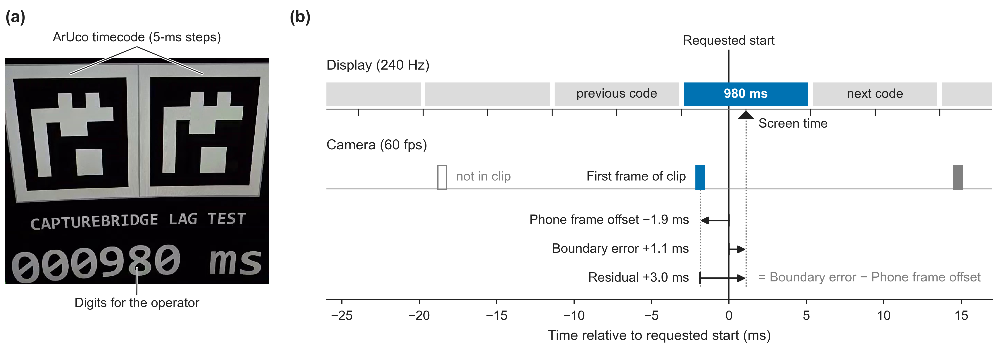
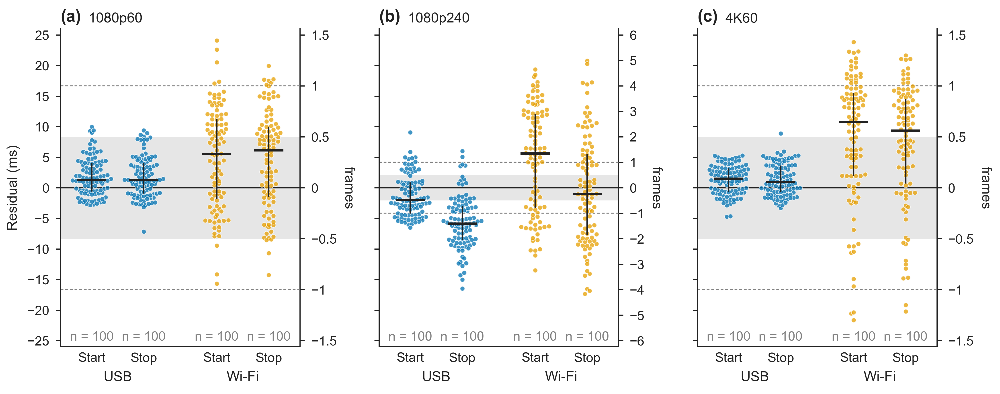

# Single-phone lag-test measurements

This directory documents single-phone measurements of the Hub's visual
boundary-timing check ([Lag Test](../README.md#lag-test)), as reported in the
CaptureBridge SoftwareX manuscript. It is not a phone-to-phone or
phone-to-reference synchronization validation.

## Repeated single-phone timing measurements

A Samsung Galaxy S25 Ultra recorded the Hub's lag-test target on a 240 Hz
Samsung Odyssey Neo G9 display, using CaptureBridge Hub v1.0.11 and
CaptureBridge Android v1.0.17. Three camera modes (1080p60, 1080p240, and 4K60)
were each recorded over a USB cable and over Wi-Fi. All recordings requested
ISO 800 and a shutter of 1/2000 s (`camera_iso`, `camera_shutter_seconds`);
above 60 fps the phone used automatic exposure and set its exposure
compensation from these values (see
[Configuration](../README.md#configuration)).

### What is measured

On Windows, the Hub records the desktop compositor (DWM) vertical blank at
which each lag-test timecode was presented. The *screen time* of an endpoint is
the midpoint of the interval during which its decoded timecode was displayed.
The *residual* is the screen time minus the phone's timestamp of the boundary
frame (first frame for start, last frame for stop), converted to the PC clock
with the clock offset used for the recording. Positive values mean that the
timecode was displayed after the frame's timestamp. The monitor's internal
processing delay and the sensor's rolling-shutter readout are not included.

The figure shows the start of one 1080p60 USB recording. The decoded timecode
was 980 ms against a requested start of 1000 ms, a raw lag of -20 ms. Its
screen time was +1.1 ms after the requested start and the first frame's
timestamp -1.9 ms, giving a residual of +3.0 ms (+0.18 frames).

### Endpoint selection

Only endpoints whose timecode was decoded directly from the boundary frame were
used. In some attempts, the decoding of an endpoint frame was not confident and
the analyzer inferred that endpoint from neighboring frames; instead of relying
on such inferred values, further attempts were recorded. For each combination
of camera mode, transport, and endpoint, the first 100 directly decoded
endpoints in recording order were used (1200 endpoints). These exclusions
reflect timecode decoding, not failed recordings.

Five Wi-Fi attempts whose fastest `SYNC` exchange took longer than 60 ms were recorded again under a rule set after part of the data had been
seen. Each repeat replaced its first recording; three repeats are among the
1200 endpoints.

### Results

| Mode | Transport | Endpoint | n | Median (ms) | Q1 to Q3 (ms) | Median (frames) | Within ½ frame | Within 1 frame | Clock-corrected median (ms) |
|---|---|---|---:|---:|---:|---:|---:|---:|---:|
| 1080p60 | USB | Start | 100 | +1.3 | -0.6 to +4.1 | +0.08 | 96% | 100% | +1.0 |
| 1080p60 | USB | Stop | 100 | +1.2 | -1.0 to +4.0 | +0.07 | 96% | 100% | +1.1 |
| 1080p60 | Wi-Fi | Start | 100 | +5.5 | -1.9 to +11.2 | +0.33 | 56% | 95% | +2.1 |
| 1080p60 | Wi-Fi | Stop | 100 | +6.1 | -1.5 to +10.0 | +0.37 | 59% | 94% | +1.5 |
| 1080p240 | USB | Start | 100 | -2.0 | -4.2 to +0.9 | -0.49 | 31% | 67% | -2.1 |
| 1080p240 | USB | Stop | 100 | -5.9 | -8.5 to -3.0 | -1.40 | 15% | 35% | -6.0 |
| 1080p240 | Wi-Fi | Start | 100 | +5.6 | -3.3 to +12.0 | +1.34 | 8% | 21% | -1.4 |
| 1080p240 | Wi-Fi | Stop | 100 | -1.0 | -7.7 to +5.5 | -0.24 | 18% | 34% | -6.0 |
| 4K60 | USB | Start | 100 | +1.5 | -0.7 to +3.2 | +0.09 | 100% | 100% | +1.4 |
| 4K60 | USB | Stop | 100 | +0.9 | -0.7 to +3.6 | +0.06 | 99% | 100% | +0.9 |
| 4K60 | Wi-Fi | Start | 100 | +10.8 | +1.9 to +15.5 | +0.65 | 34% | 77% | +1.7 |
| 4K60 | Wi-Fi | Stop | 100 | +9.3 | +0.7 to +14.5 | +0.56 | 38% | 86% | +0.5 |

Frame values use each mode's frame period (16.67 ms at 60 fps, 4.17 ms at
240 fps). Screen time was resolved to about +/-4.2 ms for 1117 of the 1200
endpoints and more coarsely for the rest; the screen times are the compositor's
timestamps, not an optical measurement of the display. Over Wi-Fi, the residuals are limited
by the error of the Hub's clock-offset estimate, which arises from asymmetric
transmission delays; with that error removed afterwards, the medians are
similar to those over USB (last column).

How the clock-offset error was determined: the Hub estimates the offset from
the `SYNC` exchange with the shortest round-trip time, assuming equal delays in
both directions. Nothing in the Hub estimates the error of this offset during
recording. Afterwards, a reference clock model (offset plus linear drift) was
fitted to each block of attempts. It lies at the centre of the band allowed by
the send and receive timestamps of all the block's exchanges (median band width
0.7-0.8 ms over USB, 2.6-2.9 ms over Wi-Fi). The clock-offset error of an
attempt is the offset the Hub used minus this reference at the target time.

### Files

- [figures/lagtest_method.pdf](figures/lagtest_method.pdf) and `.png`: timing
  quantities for one endpoint.
- [figures/lagtest_residuals.pdf](figures/lagtest_residuals.pdf) and `.png`:
  residuals of all 1200 endpoints.
- [numbers/lagtest_method.json](numbers/lagtest_method.json) and
  [numbers/lagtest_residuals.json](numbers/lagtest_residuals.json): the values
  shown in the figures and the table above. The per-attempt image path was
  removed from `lagtest_method.json` because it contains a device identifier.

The per-attempt lag-test reports and the analysis scripts are not published.

### Limitations

These results describe one phone and one display. They compare displayed
timecodes with the phone's frame timestamps and do not establish alignment
between phones or with a laboratory reference system.

## Reproduction protocol

1. Use CaptureBridge Hub v1.0.11 or newer on Windows, so that screen timing is
   recorded, with the matching Android release (v1.0.17 or newer for automatic
   brightness matching above 60 fps).
2. Connect one phone through authorized USB/ADB reverse or a trusted private
   WLAN and select the camera profile to be tested.
3. Aim the phone at the lag-test target on the left half of the screen so the
   complete green border and both timing markers remain visible.
4. Run the selected-phone Lag Test. The Hub pre-arms the encoder, refreshes
   clock samples, uses scheduled phone-clock boundaries when synchronization is
   usable, transfers the result, and analyzes the first and last saved frames.
5. Retain the generated MP4, state/segment/camera-time sidecars, JSON/CSV lag
   reports, and endpoint images. The screen-referenced fields
   (`screen_start_residual_ms`, `screen_stop_residual_ms`, and their
   half-widths) are written only for directly decoded endpoints; see
   [Lag Test](../README.md#lag-test).
6. Fix the number of endpoints and the selection rule per phone, mode,
   transport, and load condition before recording, and keep a record of every
   exclusion and repeat.

## Earlier bench observation (superseded)

An earlier author-reported check with a Samsung Galaxy S25 Ultra against a
144 Hz display, before screen timing was available, observed endpoint deviations
of 0--2 captured frames at 240 fps and 0--1 frame at 60 fps. Repetition count,
resolution, and transport were not preserved. The values are kept in
[lag_bench_observation.csv](lag_bench_observation.csv) for reference; the
measurements above supersede them.
